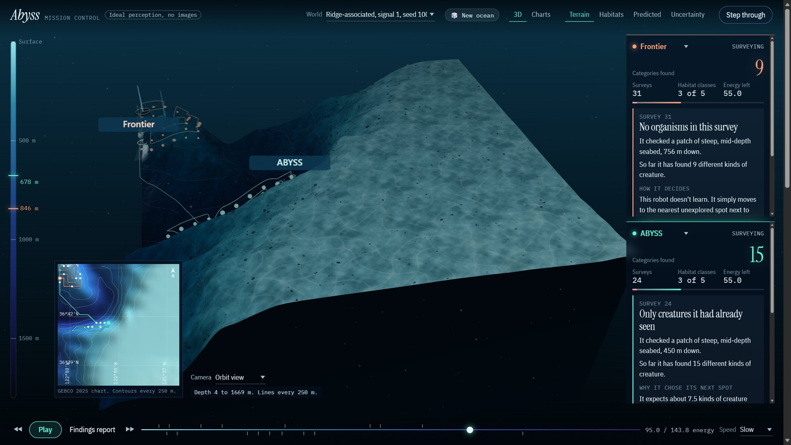
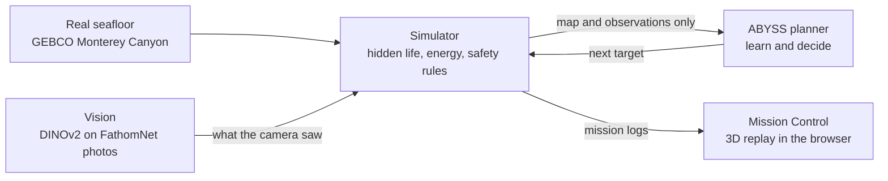

# ABYSS: Adaptive Biodiversity Exploration

**An underwater robot that learns where life is as it explores, so it finds more on one battery.**

**▶ Try it live: [abyss-ai-ui.vercel.app](https://abyss-ai-ui.vercel.app/)**. Runs in any browser, phones included.

Built in 24 hours at WHACK 2026 for the Marshall Wace New Worlds Challenge by
Rihaan, Cam and Ammar.



## The problem

Most of the deep ocean has never been surveyed, and underwater robots run on a fixed battery.
Most surveys follow a route planned before the dive, like mowing a lawn, and ignore what the
robot finds on the way. ABYSS changes its route based on what it sees.

## How it works

The robot knows the seafloor map, but not where life is. After every survey it updates its
beliefs and picks the next spot:

1. **Survey.** Photograph a spot; a vision model names the kinds of life in the photos.
2. **Learn.** A Bayesian regression model links how many kinds it found to the terrain there
   (depth, slope, ridge or valley), and tracks how sure it is.
3. **Decide.** Score every safe, unvisited spot by
   `(predicted life + learning value + new ground) / energy cost`, and go to the best one.
4. **Stay safe.** The simulator only accepts targets the robot can survey and still get home from.



## Results

Every planner ran on the same 50 held-out oceans: **6,300 missions, all returned safely.**
Settings were tuned on separate practice oceans and frozen before this run.

- Where life follows ridges, ABYSS found **4.7 more kinds of life than frontier exploration**
  (15.8 vs 11.1 out of 16; 95% interval +4.3 to +5.1).
- With learning switched off, the same robot found **3.3 fewer** on those worlds.
- The gain shrinks as the link between terrain and life weakens.
- **It does not win everywhere.** A simple lawnmower sweep beats it where life favours flat
  ground, because ABYSS predicts how much life a spot has, not whether it is new.

Full tables, confidence intervals and limitations: [docs/results.md](docs/results.md).

**This is a simulation.** The seafloor and the photos are real; where the organisms live is
simulated, so every robot can be scored against a known answer. Energy is in abstract units.

## Run it

```bash
pip install -r requirements.txt
python -m pytest -q
python -m http.server 8000 --directory ui
```

Open <http://localhost:8000> and press **Begin dive**. The replay works offline and needs no
downloads. To run your own missions, regenerate the benchmark or add real vision, see the
[developer guide](docs/DEVELOPMENT.md).

## Repository layout

| Path | What's there |
| --- | --- |
| [`abyss/`](abyss) | Simulator: terrain, hidden worlds, energy and safety rules, mission runner |
| [`abyss/learning/`](abyss/learning) | Bayesian regression model |
| [`abyss/planners/`](abyss/planners) | ABYSS planner, baselines (frontier, lawnmower, heuristic, random) and ablations |
| [`abyss/evaluation/`](abyss/evaluation) | Paired benchmark, bootstrap intervals, tuning and charts |
| [`perception/`](perception) | Vision pipeline: FathomNet crops, DINOv2 embeddings, unfamiliar-organism detection |
| [`ui/`](ui) | Mission Control: 3D and chart replay of logged missions |
| [`scripts/`](scripts) | Build replay logs, fetch GEBCO data |
| [`tests/`](tests) | Tests for safety, no hidden-data leaks, reproducibility and each component |
| [`docs/`](docs) | Results, demo guide, design notes. [Index](docs/README.md) |

## Rules the code enforces

- **No cheating.** Planners only receive the public map, their own state and what the camera
  saw. Hidden data stays in separate `.reveal.json` files, and tests check this.
- **Safe return.** A target is accepted only if
  `E_remaining >= E_travel + E_survey + E_return + E_reserve`.
- **Fair comparison.** Each world is generated once per seed, independent of the planner.
- **Separate randomness.** Terrain, world and planner never share a random stream.

## Simulated worlds

Each world keeps the same overall amount of life; only where it lives changes. A signal
strength from 0 to 1 sets how strongly life follows terrain.

| World | Where life is |
| --- | --- |
| `random` | Independent of terrain |
| `clustered` | Patches, unrelated to terrain trends |
| `ridge` | Steep, ridge-like terrain, with depth preferences |
| `reversed` | Flat terrain, with the same depth preferences |
| `nonlinear` | A depth-slope interaction the model cannot fully represent |

## Team

| Who | Built |
| --- | --- |
| **Rihaan** | Simulator, terrain and world generation, mission contract, Mission Control UI |
| **Cam** | Bayesian learner, ABYSS planner, baselines and ablations, benchmark and statistics, replay narration |
| **Ammar** | Computer vision pipeline, findings report, observation inspector |

## Data and credits

- **Bathymetry:** GEBCO Compilation Group (2025) GEBCO 2025 Grid
  (doi:10.5285/37c52e96-24ea-67ce-e063-7086abc05f29). A 30 x 30 crop of Monterey Canyon is
  committed in `data/gebco/`.
- **Imagery:** [FathomNet](https://database.fathomnet.org/). Images are not redistributed
  here; check each image's licence before showing it.
- **3D:** [Three.js](https://threejs.org/) r160 (MIT), bundled in `ui/vendor/three`.
